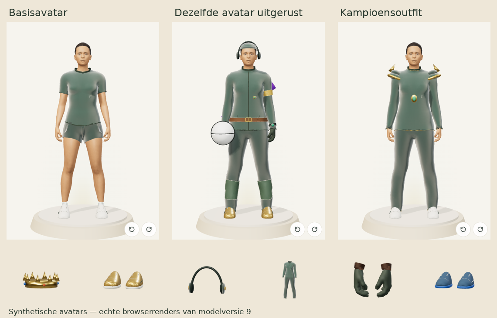
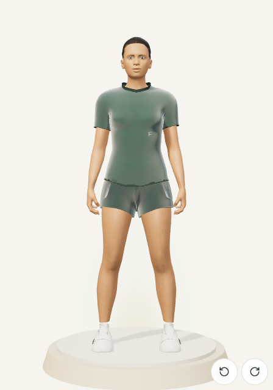
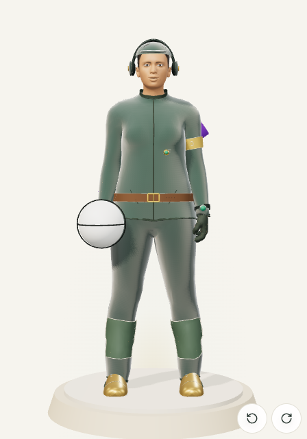
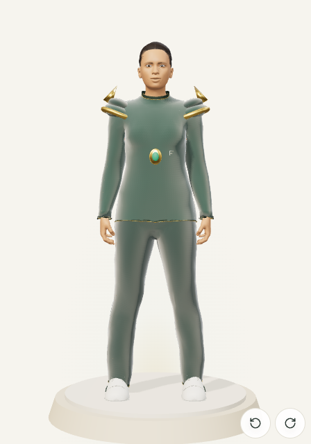
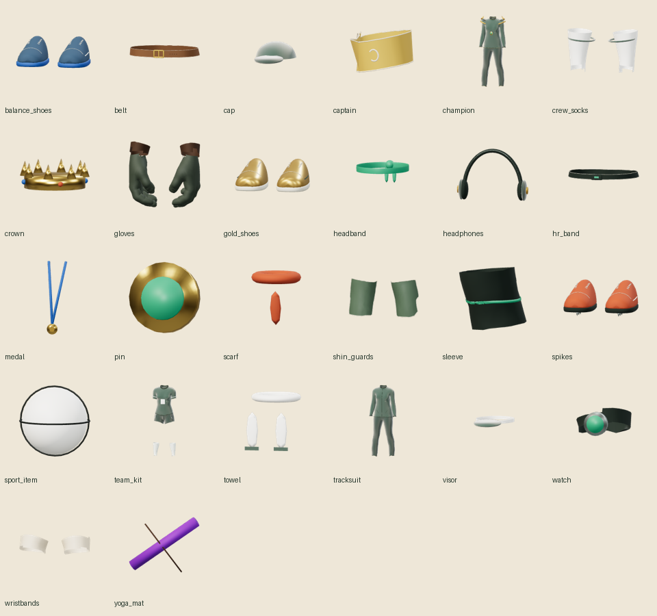

# 3D-kleding en uitrusting — modelversie 9

De inventaris heeft een optionele **3D-weergave** naast Foto en RPG. Aantrekken, uittrekken,
passen vóór aankoop, kopen, muntjes en opslaan blijven de bestaande functies gebruiken.
De gekozen weergave blijft tijdens de browsersessie behouden.

| Zonder extra uitrusting | Volledig uitgerust | Legendarisch voorbeeld |
| --- | --- | --- |
|  |  |  |

## Wat er verandert

- Een echt kledingmodel voor shirt, shorts en de complete trainings-, ski- en kampioensoutfit.
  De kleding volgt de MakeHuman-macro's en behoudt de passende botgewichten. Eigen stofstructuur,
  kraag, gevouwen randen, rits, zakken en klein FP-merkteken.
- Originele gesloten sneaker-vormen op basis van iedere voet: een afzonderlijke gevormde zool,
  hielstuk, gekruiste veters, naden en zijbies. Bestaande schoenen behouden hun eigen kleuren,
  materialen en accessoires; de pelgrimslaarzen behouden hun bestaande ontwerp.
- Koptelefoon over de oren, met hoofdband boven de pet. Doorlopende riem en hartslagband,
  om de mouw passende aanvoerdersband, sporthandschoenen en afgewerkte scheenbeschermers.
  Zachte banden en beschermers sluiten aan op de buitenkant van de kleding.
- De vijf bestaande tiers, itemlevels, rarity-kleuren en loot-reveal blijven behouden.
  Alle 26 winkelthumbnails in 3D-modus zijn renders van de daadwerkelijk gedragen meshes.
  Paren worden voor de thumbnail naast elkaar geplaatst, zonder de lege afstand tussen armen.
- Dezelfde kledingkeuze en fysieke hoogte in de losse viewer en het dorp, inclusief trainers
  en terugvalmodellen voor dorpsbewoners. Reduced motion blijft gerespecteerd.

## Beeldcontrole

Alle afbeeldingen komen uit Playwright met synthetische avatars, lokale modellen en software-WebGL.
Geen echte patiëntgegevens. De bestanden noemen frame/build en uitrusting; `-side` gebruikt de
bestaande toetsenbordknoppen. `motion-*` bevriest de echte viewer tijdens lopen, rennen of juichen.
De mobiele inventarisbeelden tonen ook passen zonder schrijven, kopen en de bestaande loot-reveal.

Materialen en silhouetten worden in meerdere lichaamsbouwen en aanzichten beoordeeld. Deze stap
is geen claim dat de gehele collectie al het artistieke afwerkingsniveau van een grote MMORPG heeft.
Verdere handmatige verfijning van haar, gezichten, plooien en afzonderlijke accessoires blijft zinvol.
Het krullenkapsel is bijvoorbeeld nog duidelijk hoekig in close-up. Extra koptelefooncontroles:
[afro](headphones-afro.png), [krullen](headphones-curly.png), [lang haar](headphones-long.png).
De vier builds zijn representatieve modellen, geen exacte lichaamsscans. Toekomstige beloningen
zoals de meestercape behouden hun bestaande ontwerp-preview; er is geen nieuwe unlockregel toegevoegd.

Bronnen en reproduceerbare bouwcommando's: [Blender README](../../tools/blender/README.md).
Vervolgcriteria: [HERO-ART-DIRECTION](../HERO-ART-DIRECTION.md).
Modelhashes en downloadmaten: [models.json](../hero3d-review/models.json).

Validatie: 75 unittests, alle 10 browserscenario’s, typecheck en productiebuild geslaagd.
Na de laatste correctie van kledinggewichten zijn de drie kleding-/inventarisscenario’s opnieuw
geslaagd, inclusief alle acht varianten, bewegingsbeelden en alle 26 items. De afbeeldingen
zijn daadwerkelijk bekeken; onder meer pasvorm, horlogeglas en bewegende naden zijn gecorrigeerd.
