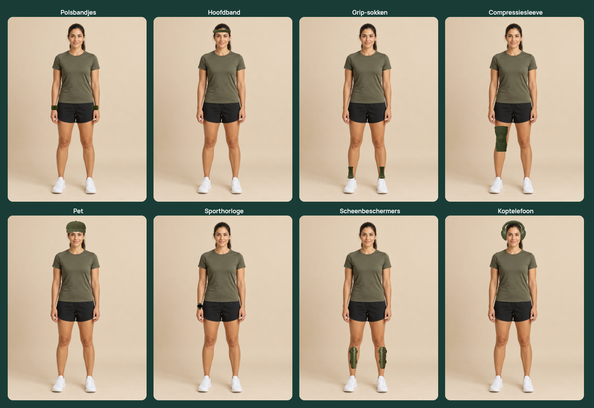
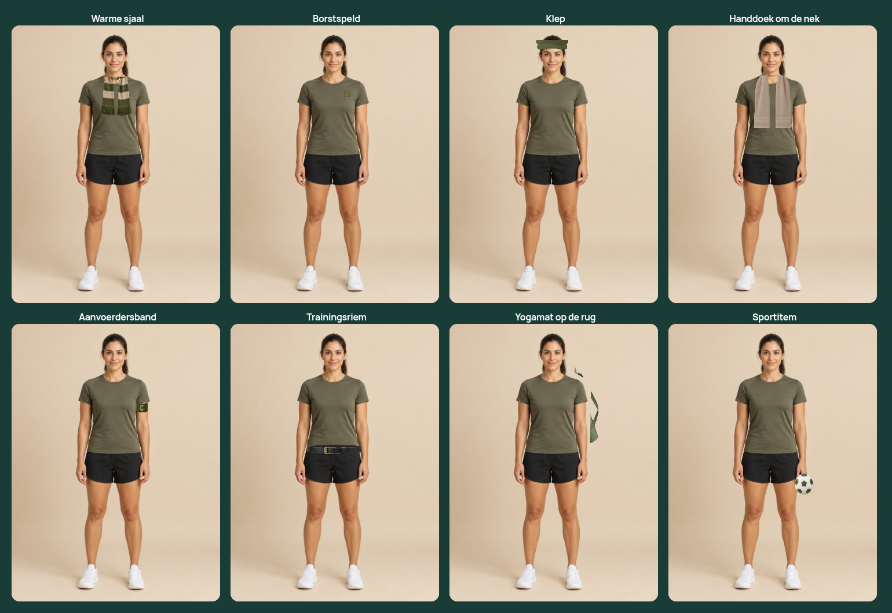
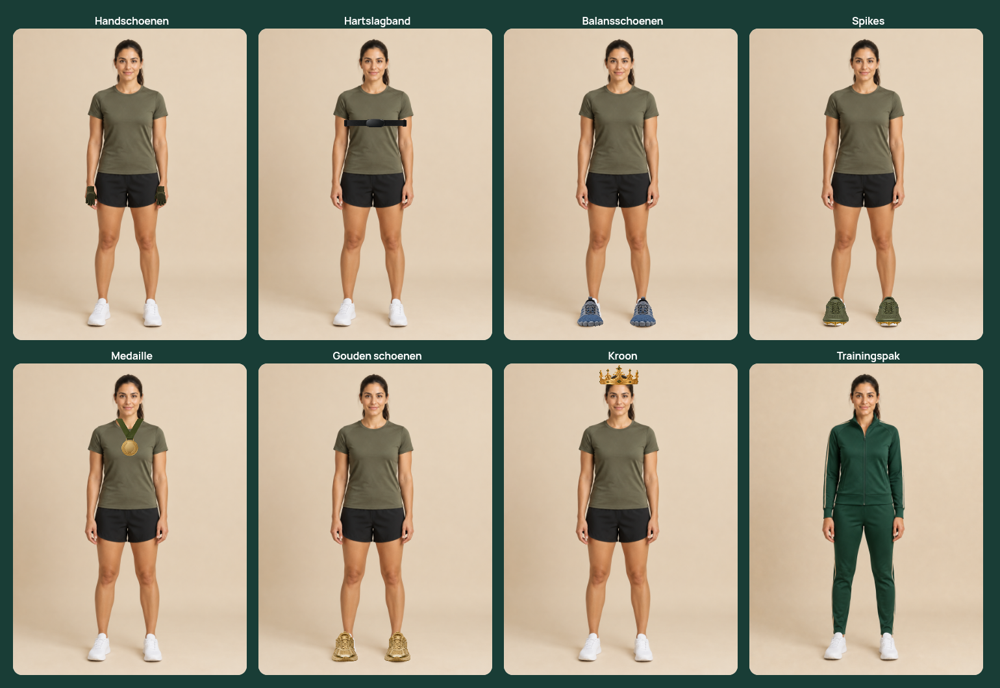
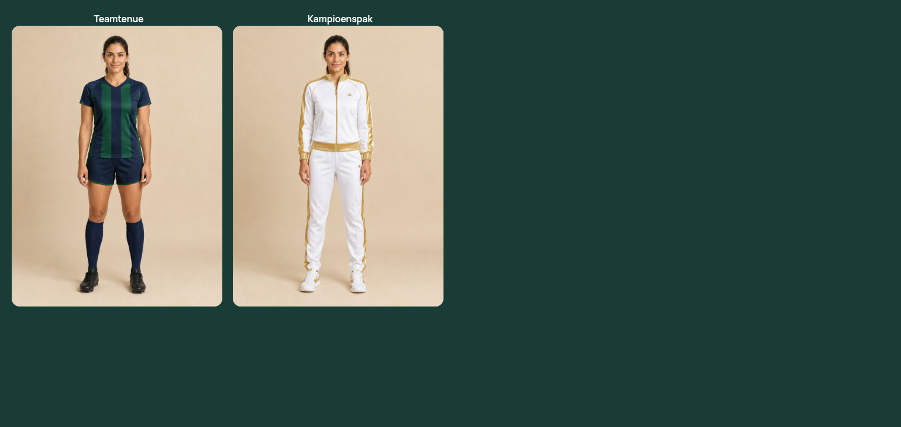

# Item collection, tiers and front-facing layers

All 26 existing items expose `itemLevel`, using their established cosmetic score. Prices, coins, ownership, gear-score calculation and equip rules are unchanged; item level is not a hero-level requirement. Inventory/shop cards and equipped slots show tier and item level explicitly. Common is slate, uncommon green, rare blue, epic purple and legendary gold, with additional frame treatments so color is not the only signal.

Photographic accessories now use front-layer crops: the scarf's rear loop, towel's back collar and visor's back strap are excluded, and headphone inner pads no longer cover the face. Thumbnail crops match these worn layers. Placement corrections cover headwear, socks, compression sleeve, captain's band, guards, hand-held ball and rear mat. Hand, foot and shin anchors are calibrated for the seven already reviewed source poses. The three distinct existing outfit images are used in the review, not substituted with a single champion image.

[Inventory and all item levels](inventory.png) · [Shop tiers and prices](shop.png)

## Rendered item sheets

The sheets were rendered in Chromium and visually inspected. The photographic Playwright fixture now equips, reloads and removes every item; checks the correct tier/itemlevel labels; checks the actual outfit source; and verifies temporary preview and mobile width. Run `python3 scripts/download-photo-review.py`, then `npx playwright test -c playwright.photo.config.ts`.

Scope: all 26 items were reviewed individually on the displayed generated avatar. This does not certify every photographic body/hair/outfit combination; the generic placement fallback and outfit-specific hairstyles still need broader review. Personal photos remain excluded from generic overlays. Tests use synthetic state, not real patient data or database durability. No merge or deployment.
