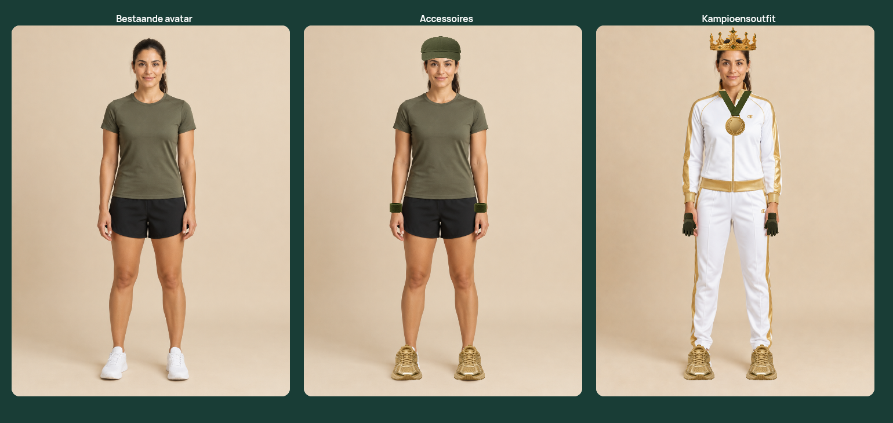
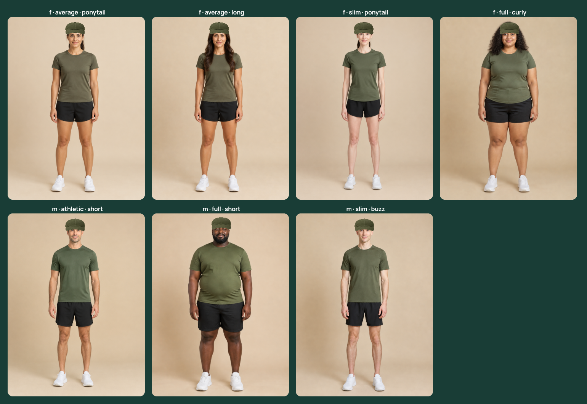
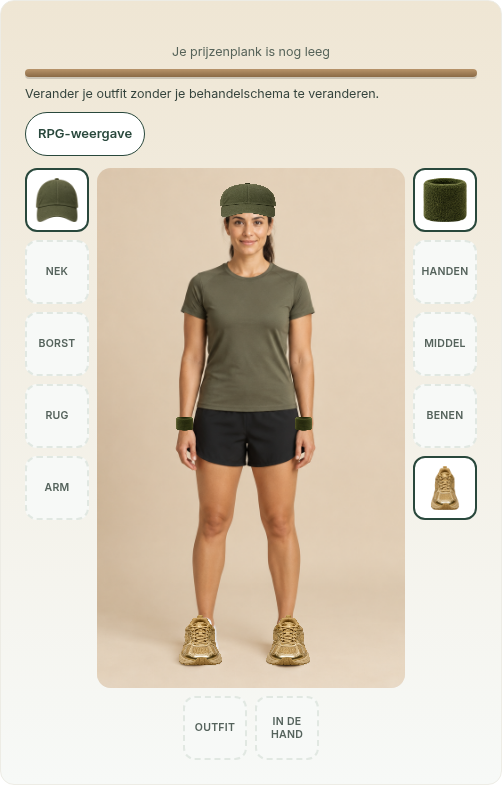
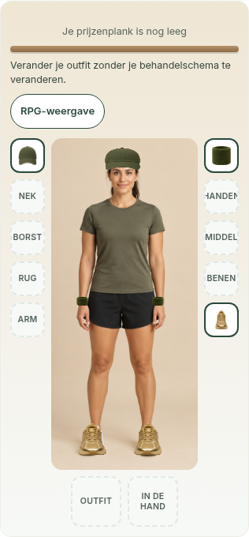

> **New catalog-wide review:** [240 avatars, 180 outfit profiles and retained hairstyles](catalog/README.md). The seven-photo review below describes the earlier implementation.

# Photographic equipment review

The inventory surround uses the original warm sand-to-off-white palette, dark readable text and forest-green focus accents. Desktop and mobile screenshots below were regenerated and visually checked after this palette correction.

The inventory now starts with the existing photographic avatar and reuses the existing photographic outfit and accessory assets. The illustrated view is retained as an optional alternative. Try-on stays in the selected view; view choice lasts for the browser session. The thumbnail and worn accessory use the same photographic texture.

This iteration reduces the cap from 16.5% to 14.5% of the photo width, lowers its dome, preserves space above the eyes, and positions headwear against the face centre rather than the image centre. Seven source images have explicit reviewed head anchors. A smoother alpha cutoff removes the old product-image halo while retaining edge antialiasing; a small shadow helps the contact edge. Hand and foot pairs use the asymmetric pose of the source photograph rather than blindly reflecting around 50%.




| Inventory | Mobile |
|---|---|
|  |  |

## Reproduce

From repository root:

```sh
python3 scripts/download-photo-review.py
npx playwright test -c playwright.photo.config.ts
```

The downloader only reads the fixed generated-art catalog. It caches art in ignored `.local-photo-review/`; no patient data or production API is used. The review HTML is a Vite development entry, not part of the production build. The fixture intercepts API requests and tests equip/reload, non-persistent try-on, viewport overflow, actual texture loading and renders screenshots. Default CI skips this optional photographic suite if its art cache is absent. The separate existing RPG suite still tests all 26 items and 64 SVG avatar combinations.

## Limits

This is a visual-review iteration, not a claim of perfect fitting across the entire generated-art catalog. Head positions were inspected for the seven pictured variants. Other photos use a generic centre until individually calibrated. Other accessory/body combinations, and rear-item occlusion, still need broader photographic review. The existing pre-rendered outfits have their own hairstyle; this change does not invent hairstyle-specific outfit images. Uploaded personal/guest photos do not receive these generic overlays. The medical body map and photo rendering outside the inventory remain unchanged.

Build, typecheck, the existing 40 relevant unit tests, and photographic Playwright checks pass. Database durability is not tested by the synthetic API fixture. No merge or deployment.
