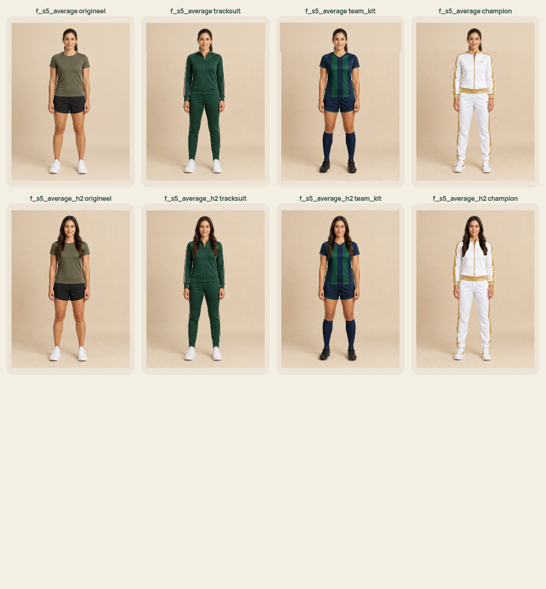
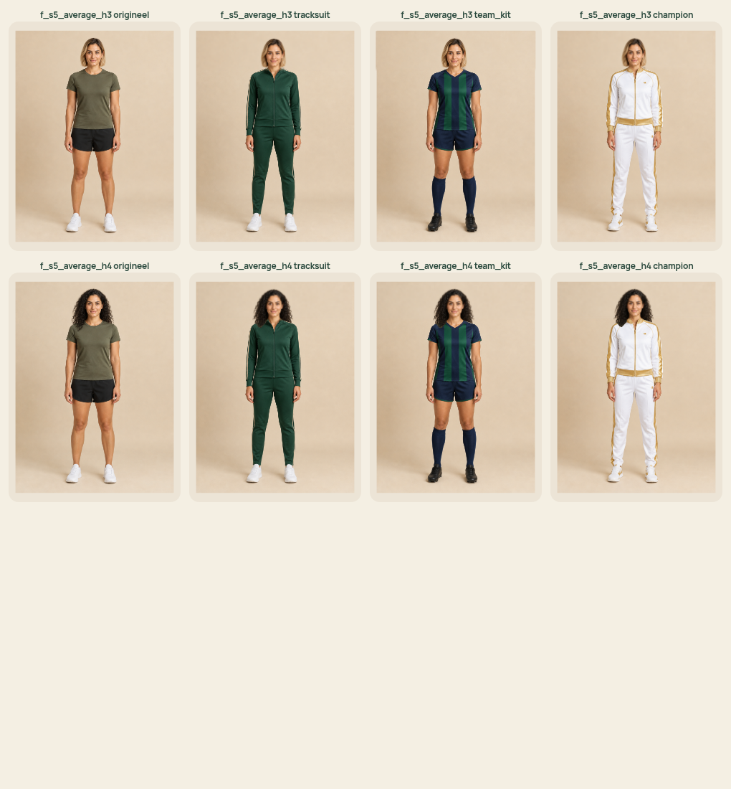
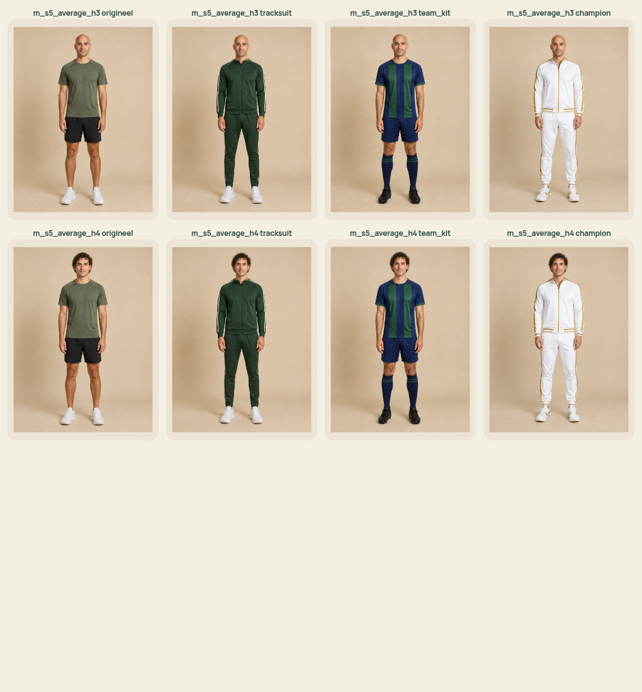
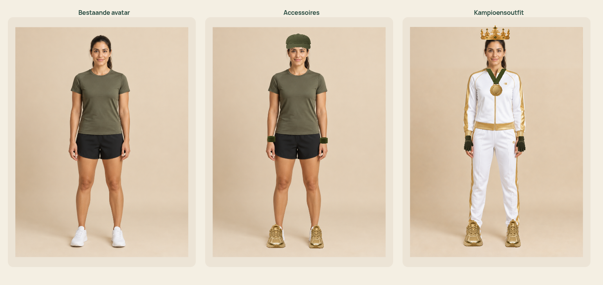
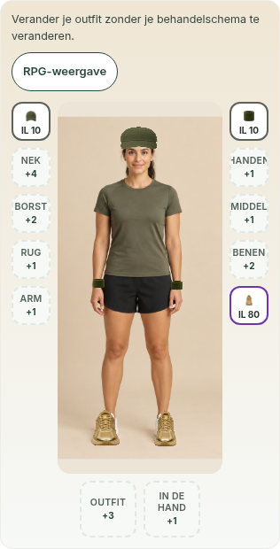
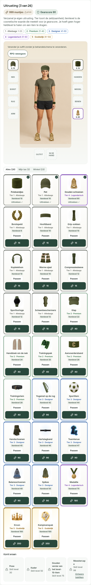
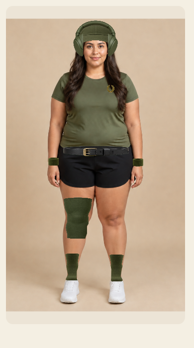
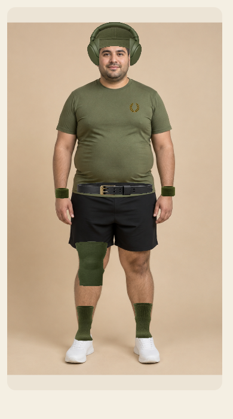
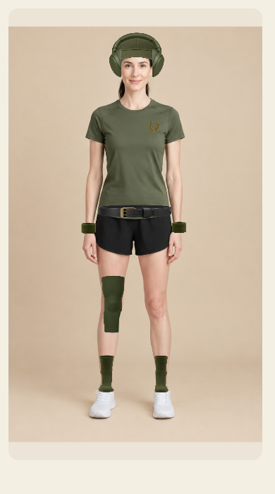

# Generated-avatar fitting review

The fixed catalog contains **240 standard avatars** (2 frames × 5 skin groups × 6 builds × 4 hairstyles) and **180 outfit photos** (2 × 5 × 6 × 3 outfits). All 420 now have measured geometry. No patient photos or records were processed.

## Changes

- Head, shoulder, wrist, hip, knee and ankle anchors come from the actual source image, including the actual outfit pose.
- Crowns use the visible head silhouette; shoes use the actual foot outline.
- The rear mat is occluded by the source silhouette instead of a generic body polygon.
- Outfit photos retain the selected original face and hair using an aligned 2D mask. Long hair extends in front of the outfit.
- The fitted view reserves 4% of its frame above/below the image to avoid cropping crowns.
- Personal/guest photos remain excluded. Geometry loads with photographic equipment.

These are image-space 2D fittings, not anatomical measurements or clinical data. Models run offline; no ML library, remote inference or camera access was added to the app.

## Evidence and limits

The 20 pose sheets show all 240 avatars with the same equipped set. All sheets were opened and inspected. Corrections included crown clearance, bald-head placement and shoe outlines. This establishes standard-catalog coverage, not pixel-perfect fitting of every possible overlapping equipment combination.

The browser check also checks the original head source in all **720 hairstyle/outfit combinations**. That source check is automated; the identity screenshots are a representative visual sample. The separate inventory fixture equips, reloads and removes all 26 items using synthetic API state. These do not test real patient storage.

Fine hair edges are polygonal; existing photographs can have slightly different lighting or face/body skin tones. Unknown future asset keys use generic placement until measured. The 720 outfit combinations are not all individually visually certified.

## Validation on the current app branch

Production build/typecheck, 49 focused unit tests, the full catalog browser check and all three synthetic photographic checks pass. The geometry is a separate equipment chunk (about 445 kB gzip); this increases the first photographic equipment load. No geometry inference runs in the browser.

## Reproduce

```sh
python3 scripts/download-photo-review.py --all
npx playwright test -c playwright.catalog.config.ts
npx playwright test -c playwright.photo.config.ts
npx vitest run -c vitest.rpg.config.ts
npm run build
```

Geometry regeneration uses `scripts/measure-photo-fit.py`, Python MediaPipe, OpenCV and NumPy, and official models:

- [Pose Landmarker Full](https://storage.googleapis.com/mediapipe-models/pose_landmarker/pose_landmarker_full/float16/1/pose_landmarker_full.task)
- [Selfie multiclass segmentation](https://storage.googleapis.com/mediapipe-models/image_segmenter/selfie_multiclass_256x256/float32/latest/selfie_multiclass_256x256.tflite)

Pass local paths with `--pose-model` and `--hair-model`. Committed geometry means app builds need no models. Existing profiles are cached; remove the generated JSON only when intentionally rebuilding every profile.

## Pose sheets

- [Poses 1–12](poses-0.png)
- [Poses 13–24](poses-1.png)
- [Poses 25–36](poses-2.png)
- [Poses 37–48](poses-3.png)
- [Poses 49–60](poses-4.png)
- [Poses 61–72](poses-5.png)
- [Poses 73–84](poses-6.png)
- [Poses 85–96](poses-7.png)
- [Poses 97–108](poses-8.png)
- [Poses 109–120](poses-9.png)
- [Poses 121–132](poses-10.png)
- [Poses 133–144](poses-11.png)
- [Poses 145–156](poses-12.png)
- [Poses 157–168](poses-13.png)
- [Poses 169–180](poses-14.png)
- [Poses 181–192](poses-15.png)
- [Poses 193–204](poses-16.png)
- [Poses 205–216](poses-17.png)
- [Poses 217–228](poses-18.png)
- [Poses 229–240](poses-19.png)

## Original avatar and three outfits









## Headwear

- [Headwear sheet 1](headwear-0.png)
- [Headwear sheet 2](headwear-1.png)
- [Headwear sheet 3](headwear-2.png)
- [Headwear sheet 4](headwear-3.png)

## Inventory and before/after







## Fuller-body leg garment correction

The live release still used generic garment placement. This follow-up now also sizes knee sleeves and socks from the measured leg outline, rather than torso height alone. Knee sleeves centre on the actual knee. Garment layers are clipped to the body silhouette, keeping their edges off the background. The contour scan separates touching legs at their knee midpoint.

Mobile screenshots cover the reported female/full/long-hair combination, two other female bodies, two fuller male avatars and a lean regression case. These are synthetic catalog fixtures with the same equipped item combination, not patient records.







Validation for this correction: build/typecheck, 48 focused tests and all three photographic Playwright checks pass. All six new mobile screenshots were opened and inspected.

## Complete item review across six avatars

All 26 items individually plus three equipped combinations were rendered for each of six fixed avatars: 174 views. All six sheets were opened and inspected. This exposed a chest band extending over the arms and covering the scarf, and headwear using the outfit photo's eye position instead of the retained face. The band is now narrower; neck accessories render in front of it; headwear follows the retained eyes. Visors sit lower on the forehead while remaining above the eyes.

The new browser check also verifies the scarf/chest-band paint order and retained identity. A geometry regression checks caps/visors against the retained eyes for all 720 outfit/hair combinations. Existing limitations about fine hair edges and footwear silhouettes still apply; this does not certify every possible item combination.

Reproduce: `npx playwright test -c playwright.wardrobe.config.ts` after downloading the full fixed catalog with `--all`.

- [All items and three combinations: f_s5_full_h2](wardrobe-f_s5_full_h2.png)
- [All items and three combinations: f_s7_full_h4](wardrobe-f_s7_full_h4.png)
- [All items and three combinations: f_s1_lean](wardrobe-f_s1_lean.png)
- [All items and three combinations: m_s5_full](wardrobe-m_s5_full.png)
- [All items and three combinations: m_s9_muscular_h3](wardrobe-m_s9_muscular_h3.png)
- [All items and three combinations: m_s1_lean_h4](wardrobe-m_s1_lean_h4.png)
