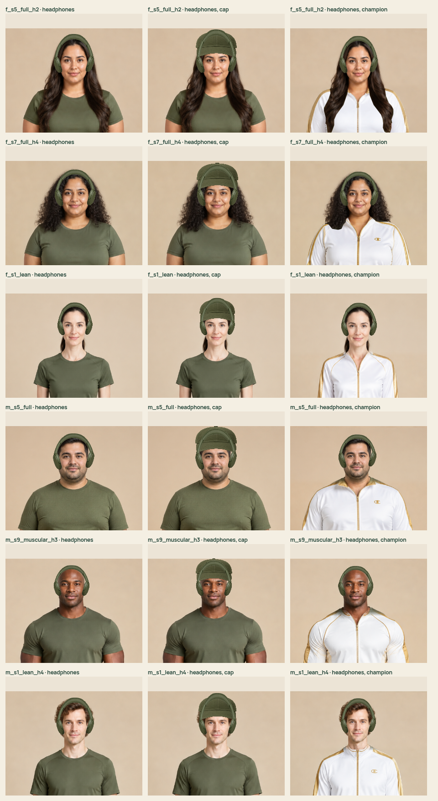
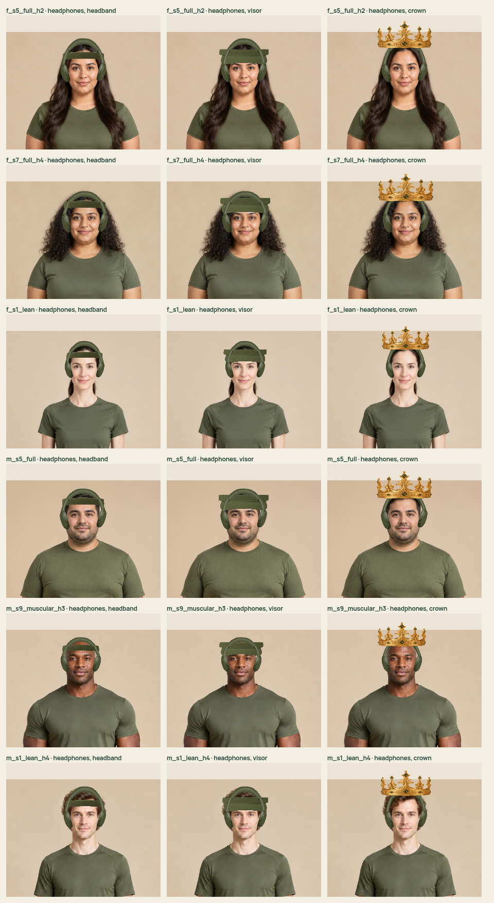

# Ear-anchored photographic headphones

The product image previously stretched as one rectangle. Its inward-facing pads covered cheeks, and the headband shared the same fixed scale as the cups.

The worn item now reuses that texture as three independently fitted parts: a thinner crown arc and two outer ear housings. Each cup uses its selected avatar ear position. The arc follows the hair/head silhouette; a cap adds clearance. Outfit photos use the retained face landmarks. Crowns paint in front of the arc. The inventory thumbnail uses the same three-part rendering and keeps its fallback if the texture cannot load.

The implementation adds no item, purchase rule, entitlement or patient-data changes. Unknown future catalog images retain the existing fallback. Personal photographs remain excluded.

Validation: production build/typecheck and 51 focused tests. Geometry checks cover 240 original avatars and 720 outfit/hair combinations. Playwright renders 36 close-ups across six avatars with short, long, curly and bald styles, with cap, visor, headband, crown and champion outfit. Both sheets were opened and inspected; the first iteration was adjusted to widen/thin the arc and move the cups outward. The photographic inventory suite checks all 26 items, reload/unequip and mobile overflow.

Reproduce after `python3 scripts/download-photo-review.py --all`:

```sh
npx playwright test -c playwright.headphones.config.ts
npx playwright test -c playwright.photo.config.ts
npx vitest run -c vitest.rpg.config.ts
npm run build
```





This is a measured 2D composition. Fine hair edges and source-photo lighting differences remain; the screenshots certify these reviewed examples, not every possible overlap at every zoom.
