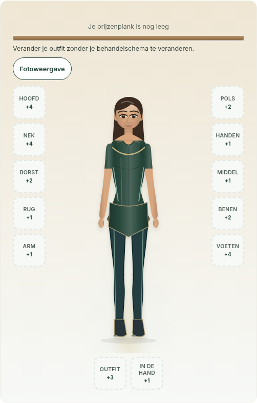
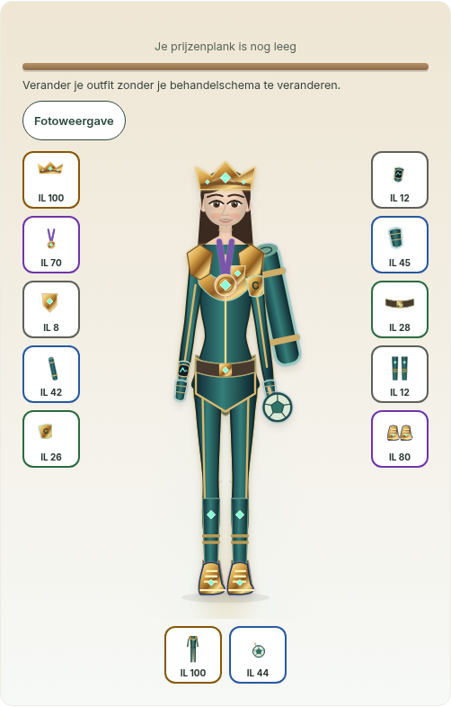
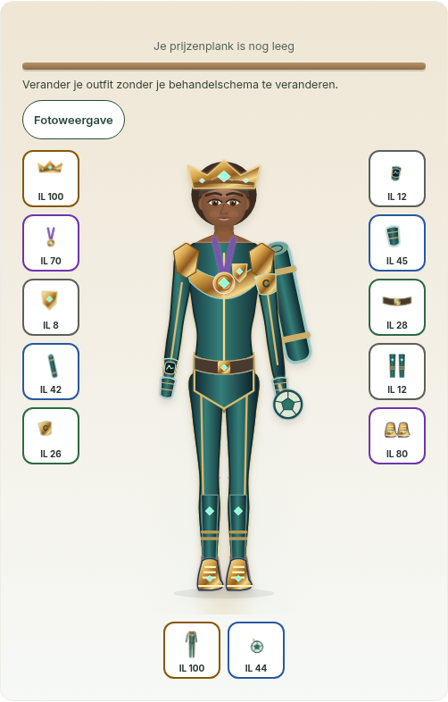
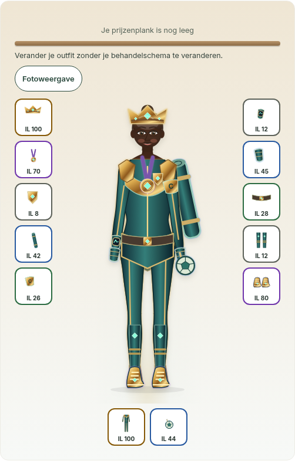
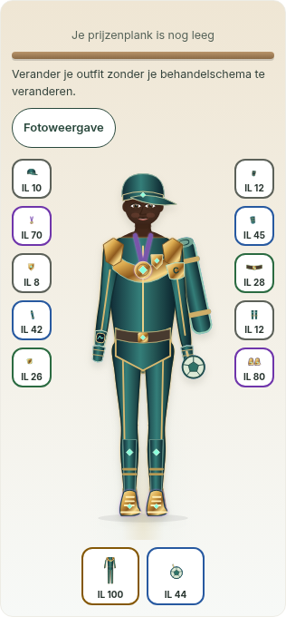

# FP Flow RPG character review

**Updated direction:** the inventory now defaults to existing photographic avatars. See [photographic fitting review](photo-fitting/README.md) for current screenshots, verification and remaining limits. The SVG implementation below remains the optional illustrated mode.

Stacked on PR #19 (`68cd3f9`). Original SVG artwork; no downloaded game assets, new economy, or patient data changes.

The optional illustrated mode renders the character as SVG. All 26 existing cosmetics now have authored art, shared between inventory thumbnails and the worn figure. Full outfits follow the existing body geometry, with layered fabric, piping and champion shoulder pieces. The mat renders behind the body. The compression sleeve follows its existing **legs** slot. A held sports ball replaces the old chest-only sport marker in RPG view. Photo rendering and clinical body-map rendering retain their existing behavior.

Shop tiles and slot dialogs offer a reversible try-on before purchase. Purchase uses the existing endpoint and shows a dismissible loot reveal only after success. Equip uses the existing one-per-slot rule and save endpoint. Motion obeys `prefers-reduced-motion`. Item tier text supplements rarity color.

The master cape has an original rear-layer design, reachable through **Ontwerp bekijken** under future rewards. It is explicitly a preview: level-99 entitlement/equip support does not exist in the current server catalog, so this change does not fabricate it or change reward criteria.

## Rendered evidence

These are actual Chromium screenshots of the application with synthetic API responses. Fixed global navigation is hidden only during the component screenshots, so it cannot cover the footwear. Screenshots were inspected; this led to a fuller base outfit, corrected SVG thumbnail paths, larger glove/pin thumbnails, more room for the mobile character and readable shelf text.

| Base outfit | Complete champion equipment |
|---|---|
|  |  |

| Athletic frame / afro | Full frame / bun | Mobile |
|---|---|---|
|  |  |  |

[Entire collection, including rare and legendary art](rpg-screenshots/collection.png) · [Master cape preview](rpg-screenshots/master-cape-preview.png) · [Loot reveal](rpg-screenshots/loot.png)

## Verification and limits

- `npm run typecheck` and `npm run build`.
- `npx vitest run -c vitest.rpg.config.ts`: 40 existing hero, photo and wear tests.
- `npx playwright test -c playwright.rpg.config.ts`: all 26 items equip/unequip and reload; purchase preview makes no write; purchase reveal; slot-dialog keyboard interaction; photo toggle; 390px viewport without horizontal overflow; reduced motion; axe WCAG A/AA inventory scan.
- 64 frame/build/hair combinations: 12-slot equipment, SVG bounds, medal/belt separation and rear-layer ordering. Three fully equipped examples captured above. These geometry assertions are complemented by visual inspection, not a claim that bounding boxes prove all visual combinations perfect.
- API writes are intercepted by a synthetic in-memory fixture. Reload verification proves client/server-response synchronization, **not PostgreSQL durability**. No real patient requests are sent.
- Full `npm test` could not run: its global setup requires a local PostgreSQL instance at port 5432, absent in this workspace. The isolated relevant suite above is provided so the UI checks are reproducible without a database. Run the repository's database integration suite in its configured CI environment before merging.

No merge or deployment was performed.
