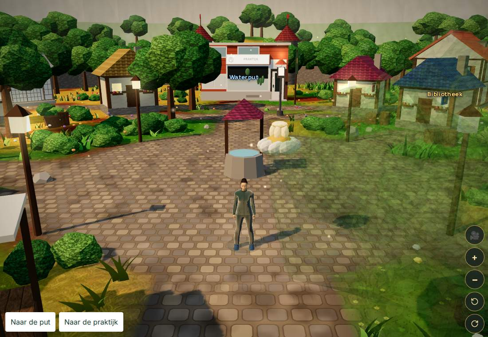
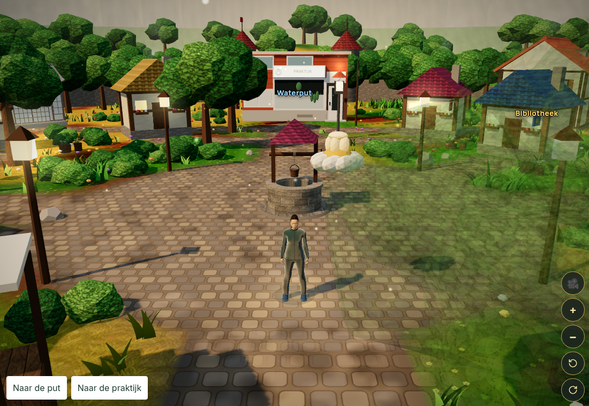
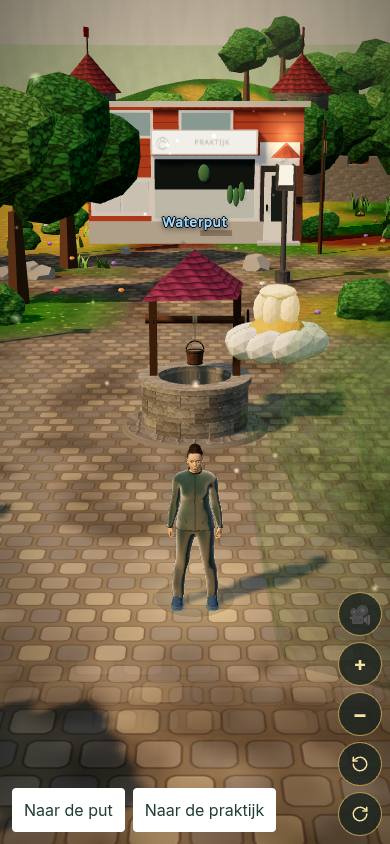
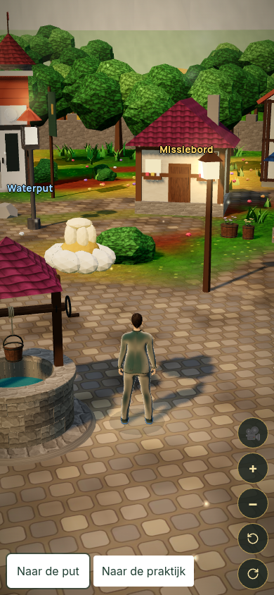
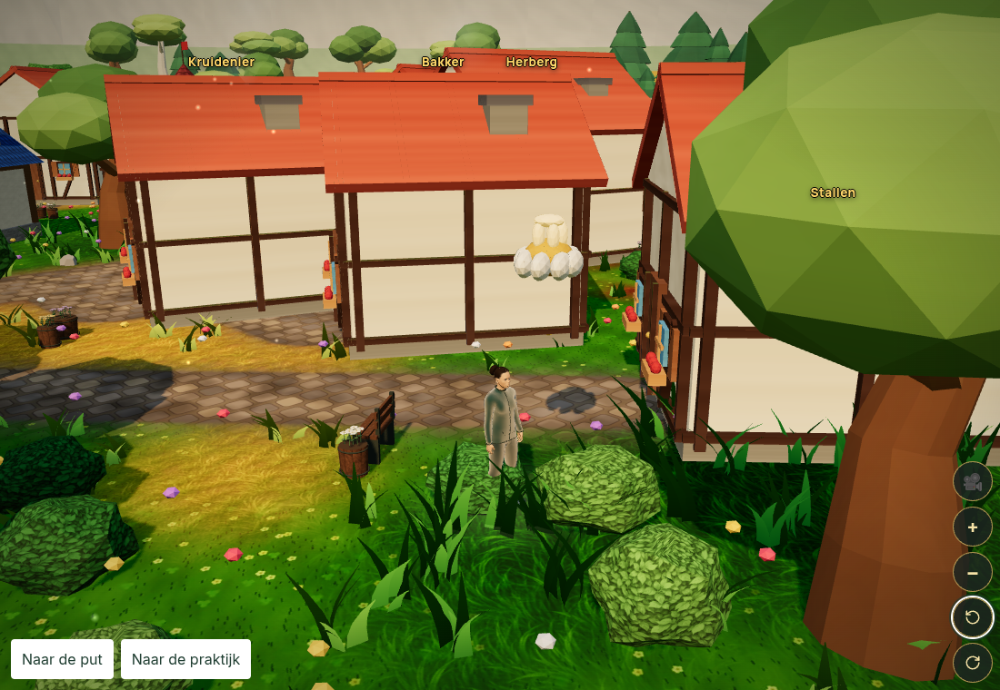
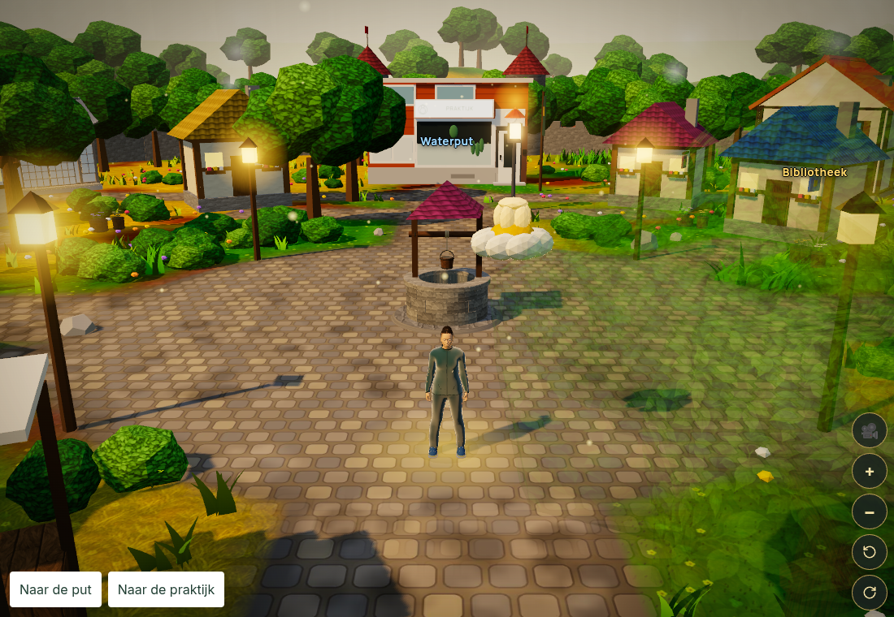

# Dorpsplein: visuele afwerking

Deze wijziging werkt het bestaande patiëntendorp af: een gemetselde waterput met
verdiept water, windas en emmer, en bloemenbakken/bankjes op de bestaande plekken
voor kisten. Dak, wegen, huizen, navigatie en spelregels blijven van het bestaande dorp.

- De nieuwe geometrie blijft binnen de bestaande botsingscirkels (put 0,95 m,
  aankleding 0,60 m). Een geometrische test controleert alle varianten vóór en na batching.
- Radiale raycasts controleren de buitenwand bij de stenen én de verspringende voegen,
  zodat de ronde put geen open gaten tussen rechthoekige blokken krijgt.
- Statische decoratie gebruikt de bestaande materiaalkaarten en prop-batching.
  Geen nieuwe lichtbronnen, netwerkassets of animatielussen.
- Alleen de planweergave krijgt deze aankleding. De andere dorpsweergave blijft behouden.
- De losse ontwikkelpagina `/village-review.html` gebruikt uitsluitend synthetische gegevens.
  Ze behoort niet tot de productie-build.

GitHub Actions `Village visual review` voert typecheck, build, RPG- en dorpsunits en
Playwright uit. Het artefact `village-visual-review` bevat echte PNG-beelden van
desktop, mobiel en de normale kleurcorrectie. Playwright controleert ook de route
naar de put en de praktijk met het toetsenbord, zonder patiënt-API's.

## Beelden

De PNG-bestanden hieronder zijn echte browseropnamen van de synthetische scène.
Dezelfde productie-renderer, gebouwen en dorpsindeling worden gebruikt.

| Vóór de afwerking | Na de afwerking |
| --- | --- |
|  |  |

| Dorpsplein | Mobiel | Waterput dichtbij |
| --- | --- | --- |
|  |  |  |

De oorspronkelijke beelden van vóór deze wijziging staan in het artefact van
[de nulmeting](https://github.com/deveritzhub/Fp-exercise/actions/runs/43930065700).
Lokaal herhalen: `FP_VILLAGE_REVIEW_LABEL=polished npx playwright test -c playwright.village-review.config.ts`.
De statische decoratie voegt zelf geen beweging toe; de browsercontrole gebruikt reduced motion.
